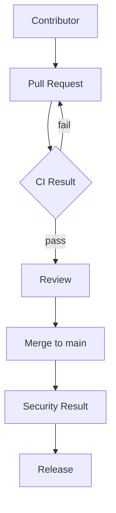

# Architecture Diagrams

This repository documents its architecture with diagrams kept under `docs/diagrams/`.

## Convention

- Diagrams are Mermaid. The source is committed inline in a Markdown fence or as a `.mmd` file alongside the rendered `.svg` so the diagram stays editable.
- Name each pair after the view it captures, for example `architecture.mmd` and `architecture.svg`.
- Reference diagrams from `README.md` so new contributors find the current architecture view on arrival.
- Re-render the `.svg` in the same change as any source edit; never commit a rendered image without its source.

## Example: Architecture View

Copy this template as `architecture.mmd` (or inline in a doc) and render it to `architecture.svg`:

Keep node labels to one to three words so rendered diagrams stay legible at small sizes.

## Status

Placeholder: no rendered diagrams yet. Add `docs/diagrams/architecture.mmd` plus its rendered `.svg` as the codebase takes shape.
